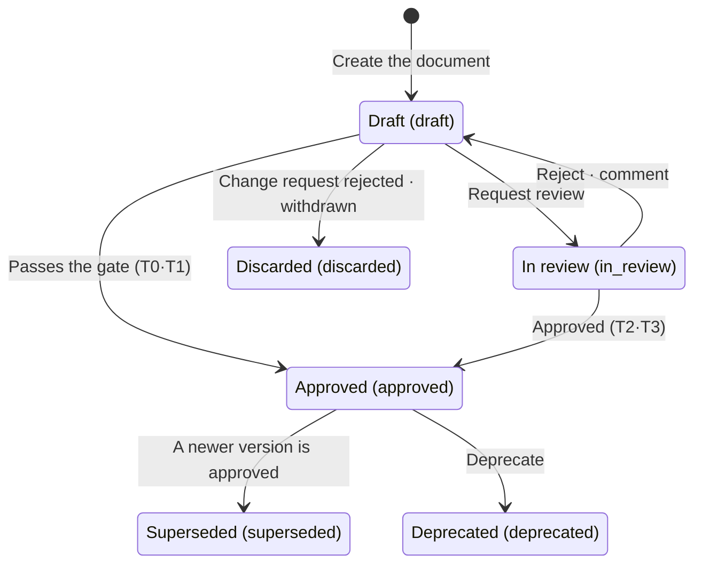
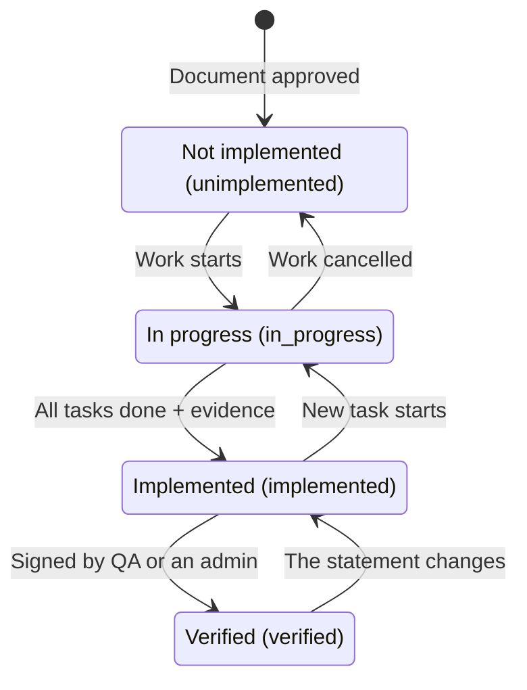

In NERV, **the spec is the reference** for all development. Agents read the spec before they start implementing.

## The tree and the types {#tree}

The tree on the left shows how your specs are organized. There are six document types, and each type is a different kind of document. When you open a document, **the path of its parent documents** (`Channels › Web chat`) appears at the very top. It shows where the document is, even on a narrow screen with the tree collapsed. Click the path to go to that document.

| Type         | What it contains                             |
| ------------ | -------------------------------------------- |
| `vision`     | What this product is                         |
| `area`       | An area (a group of child documents)         |
| `feature`    | A single feature                             |
| `design`     | Design and screens                           |
| `convention` | A convention (a way things must be done)     |
| `adr`        | A decision record (what was decided and why) |

An `area` can serve only as a group, with no body of its own. For every other type, the body is the document.

**You move or rename a document in the Document info window** ([Document info] at the top of the document · planners and admins). It has four fields: **Title**; **Parent document**, which you pick from the tree (the current parent is shown above it, and you can't pick the document itself or its descendants; pick **Top level** to detach it from its parent); **Sort key**, which orders siblings under the same parent character by character; and **Owner role**, whose members get a recheck request when a document this one references changes (if it isn't set, the default roles get it, and once set it can't be cleared). Moving or renaming keeps versions, relations and comments intact. [Save] stays disabled until you change a field.

**To move or reorder several documents at once, use Arrange mode.** On the tree tab of the spec list, click **[Arrange]** to add a checkbox to every row (planners and admins). Click the checkboxes, or press `Space` on a row, to select documents, then use the buttons in the bar that appears above the tree.

- **[Move]** — pick the new place from the tree. The selected documents go to the end of that place, in tree order. You can't pick a selected document or anything under it.
- **[Archive]** — archive the selected documents together with their children, after one confirmation. If you select a parent and its children, archiving the parent covers them. Documents that couldn't be archived because someone has claimed their tasks stay listed under the bar with the reason.
- **[Up]** · **[Down]** — move the selected documents one step among their siblings. Only documents under the same parent can move together. These are unavailable while a status, type or title filter or a baseline is on, because the documents would land between ones you can't see.

Reordering renumbers that group's sort keys as `0000010`, `0000020`, and so on. New documents and documents moved under another parent go to the end of their siblings. Click **[Done arranging]** when you're finished.

## Where you can see all of them {#all-specs}

**When you open a document, a spec tree column appears next to the sidebar.** It shows **every document, expanded**. If a list showed only some documents, you could not tell a missing document from a collapsed one. The `141 / 141` at the top of the tree means **visible / total**. When you collapse a branch, the first number drops, so you know that some documents are hidden.

**The top of the spec list shows how many documents are in each status** (draft · in review · approved …). Click a status to open the tree filtered to it, and click it again to clear the filter. Each row in the full tree ends with **the current version · last updated · open comments (speech bubble) · attachments (paperclip)**, so you can pick the documents that need work from the rows alone. Rows without comments or attachments don't show those marks. The tree column beside a document also shows the paperclip and count on documents that have attachments. Click **Has attachments N** at the top to keep only documents with attachments in the tree. You can turn it on together with a status filter, and it stays in the URL (`?attach=1`). On the table tab, click the **Attachments** column to sort by attachment count. When a document has a newer version (a draft or a version in review) on top of its approved one, its row ends with a marker such as **v4 Draft**. Click it to open that version. The number of such documents appears at the top as **New version in progress N**, and clicking it shows only those documents. Only planners and admins can use **[Create baseline]**. For other roles, the button is disabled and the reason is shown.

Turn on **Awaiting my decision** to keep only the documents in review that you can decide, with a checkbox on each row. Select documents, then click **[Approve selected]** or **[Reject selected]** in the bar above: the same confirmation as the Inbox opens, and the same rules apply (documents needing two approvals and gate bypasses are left out of bulk approval, rejecting needs a reason, and you can decide up to 50 at a time). Documents that couldn't be decided stay listed under the bar with the reason. On the table tab, a document with a newer version in review on top of its approved one shows a marker such as `v4 In review`.

Turn on **Drafts to approve** to keep only the drafts you can approve right away, with a checkbox on each row. Only admins and planners can turn it on; for other roles the chip is disabled and shows why. It cannot be on together with Awaiting my decision. Select drafts and click **[Approve now]**: the same confirmation opens, and confirming requests review and approves each selected draft in one step (the same as Approve now under "Checks and submission" below). Drafts blocked by the pre-submit check, drafts whose body changed after you selected them, and documents needing two approvals (T3) are left as they are and listed under the bar with the reason. Approve T3 documents one at a time from the document page (if an admin selects one, their approval is recorded and it waits for another approver). You can approve up to 50 at a time, and this view is kept in the address too (`?drafts=1`).

The **chevron** in front of a branch collapses or expands that branch. Branches above the document you are viewing can be collapsed too. When one of them is collapsed, a **blue dot** appears before its title to show that your document is inside it. When you move to another document, the path to it expands again.

The top row of the tree has three buttons.

- **Target** — go to the document you are viewing. It expands the branches above it and scrolls to its row. It appears only while you are viewing a document.
- **Arrows pointing apart** — expand all. Dimmed when everything is already expanded.
- **Arrows pointing together** — collapse all. It collapses everything down to the roots, even while you are viewing a document. Dimmed when everything is already collapsed.

Collapsed branches are remembered. The tree column next to a document and the spec list screen remember them **separately**.

**The tree column appears only while you are viewing a document.** On the tasks, sessions and reviews screens, that width goes to the page content. Type in **Filter by title or ID** at the top of the column to keep only the documents whose title or ID matches. A row that matched by ID shows the ID next to its title. (To search document contents, use ⌘K or the search on the spec list.) On a wide screen, **[Hide spec tree]** at the end of the column's top row hides the column, and this browser remembers that. Click the strip at the left edge to show it again. On a narrow screen, the strip opens the tree over the page, and picking a document or pressing `Esc` closes it.

To see all documents, go to **Specs** in the left menu. That screen is the **complete list**. It opens with every document expanded, and you collapse branches yourself. **If a document is not there, it is not in this project.**

Both the tree tab and the table tab show `Showing N of M`. When the two numbers differ, the difference is the number of documents that are collapsed or filtered out by **Filter by title or ID**. This screen has no separate tree column, because its tree is the full-screen version of that column.

The **Status** selector above the list shows only the documents in a given status, such as `Draft`, `In review`, or `Draft + In review`. The status is that of the version the **Version basis** selector reads. With the default (Approved), `Draft` finds only documents that were never approved. To also find drafts on top of an approved version, switch **Version basis** to **Latest** or choose `New version in progress`. What remains is **the documents in that status and their ancestors**. The ancestors don't match the filter. They remain **to show where each document belongs**, because without its parent you cannot tell where a document fits. A branch with no matching documents drops out entirely. The chosen status **stays in the URL, so a link shows someone else the same list.** The `of M` is the project's total document count and is not affected by the filter.

The **Type** selector next to it works the same way. Choose `Skeleton (vision + area)` to keep only the documents that **define the structure**, so you can see the shape of the tree at a glance. A project with 141 documents has a skeleton of 17. This helps when you decide where a new document belongs. If you set both selectors, only documents that match **both** remain.

Both selectors appear **only on the tree tab**, in the tree's control row next to **Filter by title or ID** and the expand/collapse buttons. They disappear when you switch to the table or the relations graph.

## Versions and statuses {#versions}

Specs are **never overwritten. Each change adds a new version.** Each version has one of six statuses.

- `draft` — not yet the reference for anyone.
- `in_review` — submitted and waiting for a person's decision.
- `approved` — **agents read only versions in this status.**
- `superseded` — a newer version has been approved. This version remains, but it is no longer the reference.
- `deprecated` — no longer in use.
- `discarded` — a draft that is no longer used because its change request was rejected or withdrawn. It stays on record but is never reopened (see "Change requests" below).



The diagram shows the flow of **a single version**. An approved version is never edited. Instead, you create a new version (a draft) and send it for review. When that version is approved, the previous one becomes **superseded**. Low-tier documents (T0·T1) are approved as soon as you request review, with no approval step (see "Checks and submission" below).

**There are four ways to see a draft.**

1. Switch **Version basis** above the list to **Latest (incl. drafts)**. Each document then shows its newest version, so drafts and versions in review on top of an approved version appear in the list. Choose `Draft` in the status selector to keep only drafts. See "Version basis" below for details.
2. Even with the default (Approved), a row whose document has a newer version on top of the approved one ends with a marker such as **v4 Draft**. Click it to open that version.
3. **A document that has never been approved** shows its draft even with the default.
4. Once a document is open, you can pick any version in the **Versions** tab of the rail. That list shows every version, whatever its status. Picking one changes the URL to `?v=4`, which you can share as is.

The badge at the top shows the status of the version you are viewing. If you are viewing a `superseded` version, a notice about that appears first, because reading an outdated document as if it were current is the most common mistake. If you open another version with `?v=`, the badge, version, pre-submit check, [Request review] and comments **all reflect that version**. If you are viewing the approved version and a newer draft exists, a banner above the body shows that there is a newer draft, with **[Open vN]** and **[vM→vN changes]** buttons. Links from an agent, approval cards in the Inbox, and a task's source-spec link open **that specific version**.

**The row under the title shows your next step.** A draft shows **[Request review]** and **[Approve now]** (admins and planners; see "Checks and submission" below). A document in review shows **[Open in the Inbox]**, because the decision is made on that card. To decide several documents at once while looking at the tree, turn on **Awaiting my decision** in the spec list (see "Where you can see all of them" above). An approved version shows **[Create a task]**, which opens a form for creating a task from that version (this also works for documents without requirements). The chips next to it show the **open comment count** and the **requirement count**. Clicking a chip opens that tab in the right rail. **[Hand off to an agent]** takes you to the [Continue in a terminal] card at the bottom of the rail.

## Version basis — approved, latest or a baseline {#version-basis}

The **Version basis** selector above the list sets which version of each document you read. The list, tree, table, relations graph, document pages and search all follow it.

| Version basis             | Version read for each document                                            |
| ------------------------- | ------------------------------------------------------------------------- |
| **Approved** (default)    | The latest approved version, or the draft if it was never approved        |
| **Latest (incl. drafts)** | The highest-numbered version, including drafts and versions in review     |
| A baseline name           | Only the documents in that baseline, at the captured versions (see below) |

- The choice stays in the URL (`?basis=latest`, `?baseline=R1`), so anyone you send the link to reads the same versions. The default (Approved) adds nothing to the URL.
- The choice is kept when you move to another document from the tree, the table, the relations graph, a relation row in the rail or the tree column next to a document. A version you pick in the rail's Versions tab (`?v=3`) applies only to that document.
- While you read Latest or a baseline, the Version basis selector also appears at the top of the document. Pick **Approved** there to go back to the default.
- When you read Latest and the version you see is newer than the approved one, a notice above the body says **"The approved version of this document is v3"**, with **[Open v3]** and **[v3→v4 changes]** buttons. The status badge also shows that version's status (Draft, In review), so you don't mistake a draft for the settled version.
- **Search follows the same choice.** With Approved it searches approved text, with Latest it also searches drafts and versions in review, and with a baseline it searches the versions in that baseline. The results say which versions were searched. Requirements are created when a document is approved, so requirements that exist only in a draft don't appear in the results.

## Baselines — reading the set as it was {#baselines}

Specs move ahead of implementation. New versions keep getting approved, document by document, but implementation must work against **a set of approved versions that were consistent with each other at one point in time**. Pinning the version of a single document is not enough, because the documents it references keep changing.

A **baseline** gives that set a name and freezes it.

- Create one with **[Create baseline]** above the list (planners and admins). It captures the latest approved version of every spec at that moment.
- **You cannot change a baseline after creating it.** To change the set, create a new baseline. That way, a given baseline gives the same result whenever you look at it.
- Pick a baseline in the **Version basis** selector, and **the list switches to that set**: only the documents in it, at the versions it captured. Documents created after the baseline do not appear (if they did, you might think they were part of the set). The choice stays in the URL and is kept when you open a document, so **anyone you send the link to sees the same set.**
- While a baseline is selected, **the status and type filters are hidden**. Everything in the set is approved, so there is nothing to filter.
- With **Approved** (the default), each document shows its latest approved version, or **its current version (the draft) if it has never been approved**.
- A badge at the top of the document shows which set you are reading. If the set does not include this document (because it was created later), you see the latest version marked **outside baseline**. You are never shown a different version without notice.
- **If a version was approved after the baseline, the document page tells you.** A notice above the body says "A version was approved after baseline R1: v5", with **[Open v5]** and **[v2→v5 changes]** buttons. The list shows the set as it is, so it has no such marker.
- **You can also change or clear the baseline from the document.** While you read by a baseline, the Version basis selector appears at the top of the document. Pick **Approved** to go back to the latest approved versions. The same set stays selected when you move to another document from the tree, the table, the graph, a relation row in the rail, or the left sidebar.

Tasks can have a baseline too. The agent working on such a task then reads the surrounding documents at that set's versions. To move such a task to newer versions, change its baseline (see [Tasks built on a baseline](/help/tasks#baseline-tasks) in the Tasks chapter).

## Comparing versions {#compare}

The **Versions** tab in the rail first shows the **eight most recent** versions. The number next to the tab name is the total. If a document has more than eight versions, click **[Show N older versions]** at the end of the list to see the rest. You can do two things here.

- **Compare with previous** — one click shows the changes from the version just before.
- **Pick any two** — choose any two versions in the **from** and **to** selects at the top of the comparison view.

While comparing, you see the **changes** instead of the body. Added or removed requirements come first, and line-by-line body changes follow. That is the order in which reviewers actually check.

**What you see is kept in the URL.** `?v=3` shows version 3 in full (read-only), and `?diff=v2..v3` shows the changes between two versions. Copy the URL and the other person sees the same screen, so there is no need to say "look at the third paragraph". Opening a comparison, switching to another pair, or closing it **keeps the rail tab and the baseline** as they were.

**Reverting to an earlier version.** When you open an earlier version (approved or superseded), a **[Revert to this version]** card appears above the body. Copy its command into a terminal and an agent creates **a new draft that copies the body of that version as is**.

```text
claude "/nerv:spec revert SPC-CWC-007 3"
```

- The approved version is not changed. The new draft goes through review and approval like any other draft.
- While a draft is open or a version is in review, a new draft cannot be created. The card then shows that version and what to do instead of the command, and the server refuses to overwrite the open draft.
- If the restored body is much smaller than the current one, the submission is raised to at least T2, so a person looks at it once (see "Checks and submission" below).
- In the version list, a version created by reverting shows where it came from, such as **reverted to the body of v3**.
- Roles that cannot write drafts (viewer) don't see the card.

## Attachments {#attachments}

Use the **Attachments** tab in the rail to attach mockups and documents. Drag files in or choose them.

- Nine formats: images `png` · `jpeg` · `gif` · `webp` · `svg`, documents `pdf` · `html` · `txt`, and `zip` archives.
- Size: up to **10MB** per file
- **Agents** put attachments into the body, because the web does not edit the body (see "Who writes the body" below). Images go in as images, and everything else goes in as a **link**.
- Roles with the `spec:draft` scope (planner · designer · developer · qa · admin) can upload and delete attachments. Viewers can only look.

Attachments are not only for images. Use `html`, `txt` and `zip` to upload **outputs** such as a one-page report, an extracted log, or a bundle of files.

**An attachment that an earlier version's body points to is hidden, not deleted.** Several versions can point to the same attachment, so deleting the file would break the image in every earlier version that uses it. When any version's body points to the file, the button becomes **[Hide]**: the file is kept and only removed from the list. The confirmation shows which versions point to it.

**If no version points to it, [Delete] removes the file too.** This cannot be undone, so you are asked to confirm.

**Hidden attachments are folded below the list.** Expand them to **[Restore]** one to the list, or to delete one that no version points to. Agents hide the old mockup when they replace it. Only people can delete the file itself.

Attachments belong to the **document, not a version**. Editing the draft leaves them in place, and archiving the document archives them too. The attachment count in the list and the tree matches the count on this tab; hidden attachments aren't counted. If you used an external link instead, its content could change independently of the spec's versions, and you could not later recover "the screen this version describes".

Attachments are also served through the server, so only **members of the project** can open them, even if someone else has the URL.

`html` attachments **open rendered**, so mockups and reports with scripts work. The page opens **isolated**: it cannot access your sign-in or any other NERV screen, and anything that would send what you typed elsewhere (a form submission) is blocked. All other formats, including `svg`, are displayed without scripts.

## Diagrams {#diagrams}

A ` ```mermaid ` code block in the body **is displayed as a diagram.** You don't need ASCII art. The syntax is plain [mermaid](https://mermaid.js.org).

- **The diagram is the default**, on approved documents and drafts alike.
- **[Code]** at the top right of the block shows the source. **[Diagram]** switches back.
- If the syntax is wrong, the code is shown instead, with **a notice that the diagram couldn't be rendered**. You never get an empty spot with neither a diagram nor text.
- **You can zoom in.** Use `−` and `+` at the top right to change the scale, and click the number between them to reset it to 100%. If a diagram is wider than the column, scroll it in place.
- **Full screen** (`⤡`) shows only the diagram, using the whole window. It is not a new tab, so closing it returns you to where you were reading. The scale is kept separately for the body and for full screen.
- The document always stores the code. The diagram and the scale are only ways of viewing it and are not saved in the document.

## Who writes the body {#writing}

**You don't edit the body on the web.** The web is where you read, decide, and add attachments and comments. Agents write the body.

The [Continue in a terminal] card at the bottom of the rail has the command you need. Copy it and paste it into a terminal, and the agent opens that document and continues writing.

```text
claude "/nerv:spec edit SPC-CWC-007"
```

**Why it works this way.** A web editor has to render markdown _and_ turn the edits back into markdown, and the conversion back was never complete. Some documents, such as ones with a pipe inside a table cell or consecutive block quotes, **could be opened in the editor but not saved** (3 of 22 in our measurement), and the advice at that point was "fix it in the terminal". One method that always works is better than two methods that each work halfway.

What stays on the web is **the work a person does**: requesting review, approving, editing document info (title, parent), archiving and restoring, attachments, and comments.

**In a project with no specs yet**, the spec list shows how to get started: `claude "/nerv:spec new"` to run in a terminal (with a copy button), the **Open the install guide** and **Issue a token** links if no agent is connected yet, and the CLI importer if you already have documents (see [Importing documents](/help/agents#import) in the Agents chapter). The tree in the sidebar shows a one-line link to that screen. Roles that cannot write drafts (viewer) see who writes specs instead of the command.

## Getting around a long document {#navigation}

- **[Contents ▾]** in the metadata row takes you to a section (`##`·`###`). It appears only when a document has two or more sections.
- **Clicking an anchor takes you to its section.** This applies to anchors on pre-submit check findings, anchors on comments, and `#…` links inside the body. A finding that points to a requirement number (`REQ-…`) opens the Requirements tab in the rail.
- Your position is kept in **the `#…` part of the URL**, so you can share it. Both a heading slug (`#3-gameplay`) and a section number (`#3`) work, so a section link such as `…/specs/SUD-AREA-PLAY#3` that an agent puts in the body goes straight to that section.
- Links to other specs inside the body open **within the app** (the page does not reload). External links open in a new tab.
- If the first line of the body is a `# Title` identical to the document title, the Reader view does not show it, so the title does not appear twice. It is still in the Source tab and the original.
- Lines in the Source tab have **line numbers**. The numbers are not copied, and adding `#L120` to the end of the URL takes you to that line.
- When the window is narrow and the rail is below the body, clicking a chip at the top or opening a `?rail=…` URL **scrolls you down to the rail.** You can switch rail tabs with the left and right arrow keys.

## Two ways to look at the body {#body-views}

The **Reader / Source** tabs above the body switch how you view it.

- **Reader** — the rendered view. Tables and links work, and ` ```mermaid ` blocks are displayed as diagrams.
- **Source** — the raw markdown. **[Copy]** at the top right copies all of it. If you select text by dragging to hand it to an agent, the line breaks and indentation get mixed up.

The tab you pick **stays in the URL** (`?body=source`), so a link you send opens the same view.

## Checks and submission {#checks}

You don't run the checks yourself. They run **automatically** when you open the document, and the results appear in the **Pre-submit check** panel **above** the body. The checkers look for contradictions between documents, broken chains of rationale, and requirements with no task.

If there is even one **Blocking** finding, [Request review] is disabled. The server would refuse the request anyway, so fix the blocking items first. While the button is disabled, **"N blocking pre-submit check findings"** appears next to it, and clicking it takes you to the results.

**A draft whose body shrank sharply does not slip through.** Every save overwrites the whole draft, and the previous body is not kept. So the server refuses a save that drops the size, the heading count or the kept requirements below half of the body it overwrites (bodies under 2KB are not checked). Most of the time that means the body that was sent got cut off. Only for a deliberate deletion, such as splitting a document into several, does the agent confirm with a person and then save it as an intended deletion. A draft that shrank over several saves is checked again by the pre-submit check against the **previous version**: Blocking if the deletion was not confirmed, a warning if it was.

**Requesting review does not always send the document to a person.** A gate assigns the document a tier. At the low tiers (T0, T1), it becomes `approved` **immediately, with no approval step**, and the screen shows a "passed without approval" notice. A card appears in the Inbox only at T2 and T3 (for tiers, see [Gate policy](/help/settings#gates) in the Settings chapter).

**Admins and planners can approve a draft right away.** Click **[Approve now]** in the draft's next-step row: the same impact panel as [Request review] opens, and confirming requests review and records your approval in one step. Tiers still apply. T0, T1 and T2 become `approved` immediately, with you recorded as the approver. At T3 your approval fills one slot and the document stays in review: it needs two approvals, so another approver must approve its card in the Inbox before it is final. If the pre-submit check has a blocking result, the button is disabled just like [Request review]. If an agent rewrites the draft after you opened the page, nothing is approved and the document reloads, because what you saw and what gets approved must be the same. To approve the same way from an agent session, use [`/nerv:approve`](/help/agents#skills).

**Admins and planners can approve specs they wrote themselves**, including drafts they requested or that their own session wrote. That fact is recorded in the audit log. People deciding a role slot (the second approver of a T3 document: designer, qa or developer) cannot approve their own documents. The exception is **when nobody else can approve that document**, because being unable to make any progress in a project you work on alone is worse. Anything approved this way is recorded in the audit log too. One person can never fill both slots of a T3 document.

**The author, a planner or an admin can request review.** If someone else submits it, that person becomes the requester. On a role slot, the author still cannot approve it: the server checks all three, the requester, the author, and the owner of the session that wrote it.

Agents also start the next version of an approved document. Running `/nerv:spec edit <key>` opens a new draft on top of the approved version. If a draft already exists, it continues that draft. A new draft on top of an approved version becomes a **change request** (see "Change requests" below).

**While a version is in review, no new draft can be started.** Once the review ends, work continues from the approved version, or from the same version if it was rejected and returned to draft. This keeps a document from having two drafts. In that case the agent does not edit and points you to the approval card instead.

## Comments {#comments}

Comments are attached to **a specific place in the document**, not to the document as a whole. Instead of selecting text, you choose a place under **Choose where to comment** in the comment box. You can choose a heading of the version you are viewing or a requirement number (`REQ-…`). (You type one in only when the document has nothing to choose from.) Once a comment has been addressed, close it as `resolved`.

Each comment shows **who left it (for an agent, which machine and which agent) · when · on which version**. The count next to the tab name and the chip at the top count **open comments only**. To see resolved comments and who resolved them, click **[Show N resolved]** below the list. Comments whose heading has been removed from the body are grouped at the top as comments that **lost their position**. Clicking them goes nowhere, so first check whether the point still applies. If adding or resolving a comment fails (for example, because you lack permission to resolve it), the reason is shown.

Adding a comment requires only **`spec:read`**, so a viewer can raise a point too. Only roles that can write drafts can close (resolve) comments.

Instead of a comment count, the confirmation dialog before submitting shows **how many documents reference this one and how many tasks derive from it**, so you can see first what an approval will affect. Below that, one line shows **the size against the previous version** (for example `Against the previous version v3 · size 34.8KB → 0.5KB · headings 27 → 1`). If the body shrank sharply, a further line says whether the deletion was confirmed as intended.

## Requirements {#requirements}

Requirements in a spec body are extracted, and each one tracks its own implementation status: `unimplemented` → `in_progress` → `implemented` → `verified`. Priorities are `must` · `should` · `could`.

**Each requirement is one line in the body.** The format is `- REQ-<prefix>-<number> WHEN <condition> THE SYSTEM SHALL <behaviour>`. Only the opening word varies: WHEN, WHILE or IF. `<prefix>` starts with a capital letter and may contain digits (`REQ-C24NODE-001`). A line that doesn't follow this shape doesn't become a requirement even after approval, so the pre-submit check warns about it.

```text
- REQ-CWC-031 WHEN a visitor opens the widget for the first time THE SYSTEM SHALL restore the previous conversation
- REQ-CWC-032 WHILE the connection is down THE SYSTEM SHALL queue outgoing messages
- REQ-CWC-033 IF the conversation to restore is older than 30 days THE SYSTEM SHALL start a new one
```

Agents get the number from the server, so nobody numbers requirements by hand. The **New requirement line** box at the end of the Requirements tab shows a line built from the next number the server suggests (`- REQ-CWC-034 WHEN <condition> THE SYSTEM SHALL <behaviour>`) with a copy button. Copy it and hand it to an agent, and the agent adds it after the existing requirement lines. The prefix defaults to the one this document uses, and you can change it in the box. The number is only a suggestion and becomes final when the document is approved. The server also counts the numbers written in other drafts, so two drafts written at the same time don't get the same number. Defining **a number that belongs to another document** is blocked by the pre-submit check, and approval is refused too. To move a requirement to another document, first remove the line in a new version of the original document and get it approved. **Requirement rows are created from these lines when the document is approved.** That is why the Requirements tab lists nothing for a draft that has never been approved. Instead, the top of the tab shows **the requirements the draft will create once approved**. For a draft of a document that already has an approved version, it shows **what is added, changed and removed since that version**, and **[Compare vN..vM]** opens the comparison. Lines that don't follow the format appear as warnings in the pre-submit check.

**Implementation status** on the project screen shows counts for these statuses. Of its six numbers, the last three matter most.

| Number                    | What it counts                                                                             |
| ------------------------- | ------------------------------------------------------------------------------------------ |
| Requirements              | Every live requirement                                                                     |
| Implemented               | `implemented` or `verified`                                                                |
| Verified                  | `verified`                                                                                 |
| **No evidence**           | Marked `implemented` but with **no evidence at all**                                       |
| **No task**               | Not yet implemented, and **no task has taken it on**                                       |
| **Needs re-verification** | The statement changed after verification, so **the earlier signature no longer covers it** |

**No evidence** means "you said it was done, but there is nothing to show". **No task** means "you wrote it down, but nobody took it on". Reduce the first by attaching evidence, and the second by creating a task and linking it to the requirement (see [Tasks](/help/tasks)). **Needs re-verification** is explained below.

**You can also see it by area.** If the spec tree has `area` documents, **By area** below the numbers shows one row per area. It gathers the requirements of the specs under that area document (at any depth) into one bar with implemented and verified counts, and lists No evidence, No task and Needs re-verification only when they are not zero. Click an area name to see its requirements in [Implementation status in detail](#coverage). Specs that belong to no area are gathered into the last row, **Specs outside any area**. Areas with no requirements are not shown.

**To find out which requirements they are, use the implementation status screen or the document.** The project screen shows only counts. Click a number to open [Implementation status in detail](#coverage) filtered by it. The **Requirements** tab on the right of a spec lists that document's requirements, one per row, with derived-task and evidence counts on each. A row where both are zero is shown in **red**. Below it, **Derived tasks** lists the tasks from this document that are `ready`, `in_progress` or `blocked`. [See all on the board] opens the task board with the same filter.

Requirement rows are created from the body **when a version is approved**. Writing EARS sentences in a draft does not create them, because a draft is not yet a commitment. When a sentence is removed in a later version, the row is not deleted. Instead, **the version that removed it** is recorded.

The default priority is `must`, because an EARS line in the body does not include a priority. Imported requirements are different: if the source states no priority, it is **left empty** (the screen shows "no priority"). Filling in `must` when the source never said so would make it look as if the source had set it.

**People don't set implementation status by hand.** The server derives it from the tasks created from that requirement.

| Status          | When                                                                                                                  |
| --------------- | --------------------------------------------------------------------------------------------------------------------- |
| `unimplemented` | Nothing started and nothing done (every derived task is `backlog`, `ready` or `blocked`)                              |
| `in_progress`   | At least one is **claimed** or in progress, or some are done but not all                                              |
| `implemented`   | All are `done` **and** there is at least one piece of evidence                                                        |
| `verified`      | `implemented`, with a test record signed by QA or an admin, and no open `critical` in the review of the latest commit |



**If all tasks are done but there is no evidence, the status stays `in_progress`.** To call it finished, attach something to show. **Verification comes from a test record left by QA or an admin.** Nobody raises the status by hand. When that signature exists, the server marks the requirement `verified`. Open `critical` findings are checked only when the requirement is about to become `verified`. They are counted in the reviews of each task's latest commit. If a new commit came after a review, that commit must be reviewed before the requirement is verified, and findings left from earlier reviews do not block it once the new commit's review is clean. If a task has no commit evidence or was never reviewed, the server looks for open `critical` findings on the requirement itself. Once verified, it does not drop when a finding opens later. A test record attached by an agent does not count as a signature.

**Status can also go back.** If a claim is released and no task is in progress any more, it returns to `unimplemented`. If a new task starts on an implemented requirement, it returns to `in_progress`. Both reflect where the work currently stands. Evidence whose target no longer exists does not count. Status values that came in through the importer stay as they are until a task is linked to that requirement. Such a value is marked **Source: import**. It means no task is linked, so the server has not derived it, and the import read it from the document.

**When the statement changes, the verification is cleared.** A verification signature applies only to the statement as it was when signed. When a new version changes a requirement's statement, the earlier signature does not cover the new one. So `verified` goes back to `implemented`, and the Requirements tab shows **Needs re-verification**. Changes to whitespace or formatting alone (such as bold) do not count.

A person clears this mark. QA or an admin either signs a new test record or, if the earlier test still holds for the changed statement, clicks **[Confirm no impact]** to sign the same test again. You are asked once to confirm what you are signing, and the signature is recorded. A test attached by an agent is not a signature and cannot clear the mark.

**A re-verification task changes the implementation status only once it is started.** When a change request is approved, a re-verification task is created in `backlog` for each done task of a reworded requirement. The task exists so that a person decides whether to check again. While nobody has started it (it is `backlog`, `ready` or `blocked` and has never been claimed), it is not counted when the implementation status is calculated. So when QA signs again with **[Confirm no impact]**, the requirement returns to `verified` even though the re-verification task is still open. Once the task is claimed, it counts like any other task, even if the claim is released and it goes back to `ready`. If you decide not to check again, archive the task.

The top of the document can also show the badge **A referenced document changed**. It appears when a document this one references has changed since the version you are reading, and it shows **which document** changed. The server determines this; the screen does not guess.

## Relations and backlinks {#relations}

When you write another document as a **link** in the body, a `references` relation is created **automatically**. A link here means a **Markdown link**: a title in square brackets followed immediately by the URL in parentheses. A spec key typed as plain text in a sentence creates no relation, because only places where a person explicitly marked "this is that document" count. The other relations (`refines` · `depends_on` · `duplicates` · `supersedes`) can only be judged by reading, so a person or an agent declares them.

The **Relations** tab in the right rail shows both kinds. Its sub-tabs split them by direction, because each direction answers a different question.

| Sub-tab        | What it shows                                                      |
| -------------- | ------------------------------------------------------------------ |
| **All**        | Both directions                                                    |
| **Backlinks**  | Documents that **point to this one** (affected when you change it) |
| **References** | Documents **this one points to** (what it depends on)              |

The number next to each sub-tab name is the count for that direction. You can see the count before clicking, so you never need to open an empty tab.

The **relations graph** shows the same relations as a picture. It is the `Relations` tab on the spec list screen. Clicking a node does **not** open that document. Instead, it highlights the node and everything linked to it, and opens a panel on the right with the document's name and its neighbors (backlinks / references). To go to the document, **click its name in the panel.** Click the background or press `Esc` to clear the selection. **The view you are on (tree, table, graph), the graph's center document and the layout number stay in the URL.** If you open a document and come back, the view is as you left it, and if you share the link, the other person sees the same graph. **[View in graph →]** at the top of the **Relations** tab in a document's rail opens the graph centered on that document.

**Color shows the document type, and size shows the backlink count.** The **legend at the bottom left** of the canvas explains both. Vision, feature, design, convention and decision each have their own color. Areas are drawn as pale rectangles instead of circles, so the legend shows them as rectangles too. The legend lists **only the types currently drawn**.

A bigger node means more documents point to it. Keep two things in mind so you don't misread it. The most-referenced documents **stop growing at a certain size** (there is a cap, so a single hub cannot take over the picture). Also, size counts only **what is currently drawn**, so the same document looks smaller in centered view. **For the exact number, click the node** and check the `Backlinks` tab in the panel on the right. The panel header also shows the selected document's color dot and type, so you don't have to look it up in the legend.

**Drag the background to pan**, and scroll to zoom. Dragging inside an area box (the pale rectangle around a group of documents) also pans. To select the box, **click it once**.

**Sibling area boxes never overlap.** So when one box is drawn inside another, it really is a parent-child relationship. You never have to guess whether boxes are nested or just overlapping.

The graph controls are in the **top left of the canvas**: view scope (**Whole project** / **Around this doc**), **Group by area**, [Another layout], and a **`?`** button. The `?` button opens **How to read** (color, size, fading), **Gestures** and the **Fast rendering (WebGL)** switch. Node and edge counts are in the bottom-right corner, and the legend is in the bottom-left corner.

**The same documents and relations always get the same layout.** Reload the page, have someone else open it, or use a different window size, and each document is in the same place, so you can learn where things are (in a small graph whose names are drawn, the layout may shift slightly to make room for the names). When an agent only changes a document's content or status, the picture stays as it is; the graph is laid out again only when documents or relations are added or removed.

**Adding or removing documents keeps the shape of the picture.** After the new layout, the documents around each document are still in the same directions, and a new document finds its place inside its own area. One new document does not scramble the places you have learned. Turning area grouping on or off also keeps documents in the same directions.

**[Another layout]** shows a different arrangement, which helps untangle a knot. Each click raises the layout number by one, and the number stays in the URL, so you can share that layout as a link. When the number is not 1, **Layout N** and **[First layout]** appear next to it; [First layout] returns to the default layout.

**You can drag nodes.** Use this to pull apart a crowded spot. The new position is kept only in this view and does not change the document's position in the tree. After you drag a node, **[Undo moves]** appears and puts the nodes back where this layout placed them. Switching center mode or area grouping, or showing another layout, also discards your moves.

The graph is drawn with **WebGL**, so zooming and panning stay smooth. If the picture looks broken, turn off **Fast rendering (WebGL)** under `?`. The page reloads and draws on a regular canvas. Browsers without WebGL support use the regular canvas from the start.

When zoomed out, **document names are hidden.** A hundred labels too small to read would only smudge the picture. Zoom in and the names come back. Area names are shown at any zoom level.

**When two names overlap, only one is shown.** A name covered by another is unreadable anyway, so the one with more backlinks keeps its label. Zooming in does **not** bring the hidden name back, because the text grows with the picture and the overlap stays the same. Instead, use one of three options: **click the node** (a selected document always shows its name, and once the rest fades, its neighbors' names come back), **drag the nodes apart**, or use the **table tab**. The panel on the right also lists the names as text.

## Archiving {#archive}

**Clicking [Archive] in the Document info window opens a confirmation.** Archiving removes the document from the list and the tree, and the only way back is [Restore] on the document's own page. Esc closes only the confirmation. Press it again to close the Document info window.

**Child documents are archived together with it.** The confirmation lists every child document that will be archived, and confirming archives the whole branch at once. To keep a child, first move it elsewhere in [Document info]. There is no way to archive only the parent, because child documents that drop out of the lists could not be found again. Children you already archived separately stay as they are.

Archiving can be **refused**. You can't archive it if someone has claimed a task derived from the document or one of its children. In that case, the screen lists what is blocking it, and each key takes you to the task you need to deal with.

Archiving is **not deletion.** The document disappears from lists and the tree, but it still opens at its URL, and links to it keep working. A spec is the record of what was decided and why. Deleting it would erase that record.

There is **no way to delete a spec permanently**, and its key can't be changed. Archive a document you no longer use. An archived document keeps its key, so you can't create a new document with the same key; restore the old one and keep writing there.

An archived document is **no longer a basis for work.** Tasks derived from it leave the task queue, and agents can't take them on. If unfinished tasks remain when you archive, you're told how many; clean them up on the task board. You also can't save a draft to an archived document or request a review. Restore it first if you want to keep writing.

To **see archived documents again**, turn on **Show archived** at the top of the spec list. They reappear in the list marked `Archived`. The setting stays in the URL (`?archived=true`), so a link you share shows the other person the same list.

**You restore a document from its own page.** When you open an archived spec, a banner appears at the top, and planners and admins also see a **Restore** button. **Child documents archived together with it are restored too**; children you archived separately before stay archived. If its parent is archived, the restore is refused, and the screen shows the key of the document to restore first. When several levels above are archived, that's the topmost one.

You **cannot create a document under an archived one**, and you cannot move an existing document under it either. Otherwise that document would appear in no list at all, and even the person who created it could not find it again.

## Implementation status in detail {#coverage}

Click **[Details]**, a number or an area name on the **Implementation status** card of the project screen to open the implementation status screen (`/p/<project>/coverage`). There you drill down from **area to document to requirement** to see which requirements are still open.

- **Areas**: one row per `area` document, with the same bar and counts as By area on the project screen. Only warnings that are not zero are listed. Click the name to go down to the area's documents, or **[Open document]** to open the area document. Specs that belong to no area are gathered into one row, **Specs outside any area**.
- **Documents**: only the documents under that area that have requirements. Click a name to go down to its requirements.
- **Requirements**: each row shows the fixed ID, the implementation status, markers (No evidence, No task, Needs re-verification, Source: import), the statement, and the counts of derived tasks and evidence.

Click **No evidence**, **No task**, **Needs re-verification** or **Source: import** in the top row to keep only the requirements that match. Click it again to clear it. A condition with no matches can't be turned on. At the area and document levels, rows with a zero count for that condition are hidden too. All numbers and markers come from the server, and the screen does not count them on its own.

**Click a requirement to expand it.** It shows the tasks created from it, its evidence, the findings that point at it (open and resolved) and the five most recent reviews. Each row links to the task, the repository or the review center. Resolved findings open in the review center with the filter that shows every status.

**If there is no verification evidence, create a verification task right there.** When no test record signed by QA or an admin covers the current statement, **[Create verification task]** appears. It opens the new task form on the task board with the document's latest approved version and this requirement filled in as the source. It is the same form as **[Create a task from this requirement]** in the Requirements tab of a spec. If the document has no approved version, or your role can't create tasks, the button is locked and shows why.

**Source: import** marks an implementation status the server has not derived because no task is linked. Overwriting the values the import read from the documents with `unimplemented` would drop a migrated team's progress to zero overnight. So the value stays as it is, and the screen shows where it came from. Below the top row you see **the share of requirements derived from links** together with **the number of requirements still holding an imported value**. The marker disappears once a task is linked and the server sets the status again.

The level you are on, the condition you turned on and the requirement you expanded are all part of the address. Share the link and the other person sees the same place. Every project member can open this screen, viewers included.

## Change requests {#change-requests}

**When you create a new draft for a document that already has an approved version, that draft becomes a change request (CR).** You don't create one separately. The server opens it the moment the draft is saved or an old version is restored. The first draft of a document that has never been approved is not a change request. A change request gets a key like a task (`CLV-C-4K9Q2M`), and a document has at most one open change request.

**The draft version is what gets approved.** A change request has no approval of its own. Its status follows the version.

| Status    | When                                                                                                               |
| --------- | ------------------------------------------------------------------------------------------------------------------ |
| Open      | The draft is being written. It is also open again when an approval is rejected or expires and the draft comes back |
| In review | Review was requested for the draft. The risk comes from that version's tier (T0·T1 low · T2 normal · T3 high)      |
| Approved  | The version was approved                                                                                           |
| Rejected  | A planner or admin decided not to make this change. A reason is required                                           |
| Withdrawn | The person who opened the change request or wrote the draft withdrew it                                            |

**Rejecting or withdrawing discards the draft.** A discarded draft is kept so you can see what the change request proposed, but it is never reopened. The document goes back to its approved version, and the next save starts a new draft with a new number and a new change request. If you need the discarded text again, restore that version to start a new draft.

**This is not the same as rejecting an approval.** Rejecting an approval means "fix it and submit again", so the draft and the change request stay open. A change request in review can't be rejected; finish the approval first.

**The change request screen** (`/p/<project>/crs/<key>`) shows one proposal from top to bottom.

1. **Changed requirements**: only the difference between the approved version and the draft. You don't pick versions to compare.
2. **What moves on approval**: what the approval does to each task created from this document (rebrief · suggest re-verification · suggest archiving · confirm stop · nothing), active claims (person · machine) and the documents that reference this one.
3. **Follow-up on approval**: a checklist. **Create derived tasks** for added requirements, **create re-verification tasks** that re-check done tasks of reworded requirements, and **archive** tasks not yet started for removed requirements. Derive and re-verify are checked in advance; you pick archiving yourself. When you approve on this screen, the server does only what you checked, together with the approval, and new tasks go to `backlog`. Approving with nothing checked is recorded as choosing to do nothing. If nobody has chosen yet, the list says so: approving without this screen, from the Inbox card or with [Approve now], applies the same defaults as the advance checks (derive and re-verify).
4. **Decision**: an open change request shows **[Approve now]** (admins and planners), **[Reject change request]** and **[Withdraw]** (the person who opened it or the author). In review, it shows **[Approve]** and **[Reject approval]** for that version's approval. After you approve, the decision notice also says how many tasks were created. An approved change request shows, instead of the decision buttons, the tasks it created and archived, and whether it did what was chosen or applied the defaults because nothing was chosen.

If a session holds a claim on a task whose requirement changed or was removed, the person behind that session gets an **important notification** when the change request opens and when it is approved. A session whose task lost its requirement gets a stop-confirmation request on its next heartbeat. The agent stops instead of continuing and asks the person.

You can open a change request from the **change request chip** under the document title, the key on each row of the **Versions** tab in the rail, the **change request card** in the Inbox, and search or ⌘K (type the key). The [Request review] and [Approve now] panels also show the number of active claims and a link to the change request. The [Approve now] panel shows what approval will do in the same line as the Inbox card: what was chosen, or if nobody has chosen, the defaults (create derived and re-verification tasks, archive nothing).
